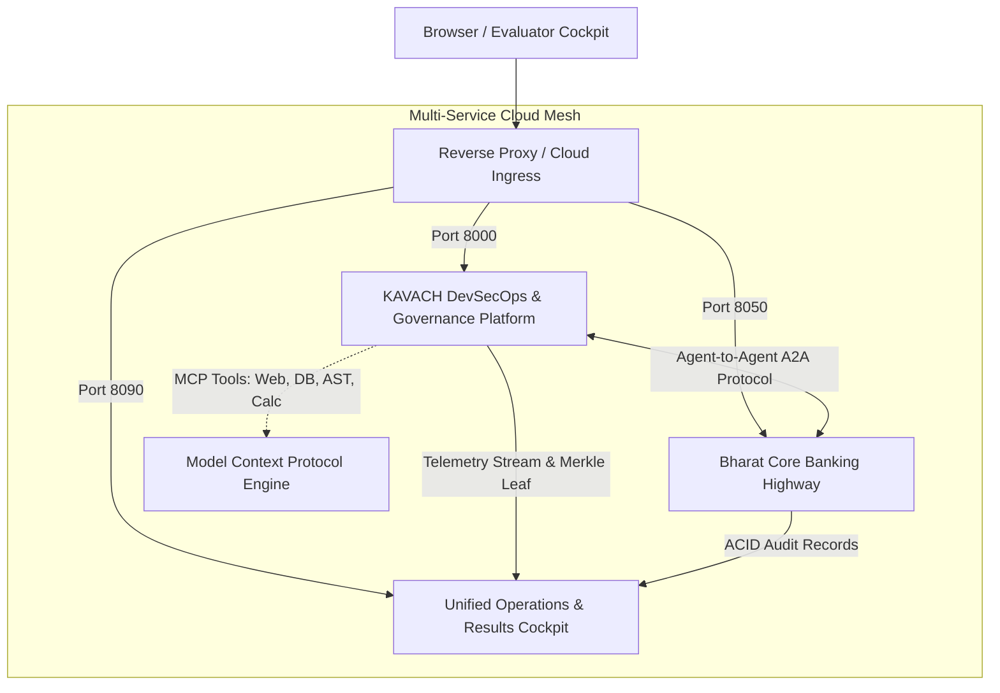

# KAVACH Capstone Cloud Deployment Guide
### Multi-Service Agentic AI Architecture (Ports 8000, 8050, 8090)
**Complies with Point 11 of Professor Pranshu Tiwari's Project Review Requirements**

---

## 1. Architectural Topology Overview

The KAVACH platform is containerized as a decoupled, multi-service zero-trust microservice mesh:



| Service | Port | Description | Health Check Probe |
| :--- | :--- | :--- | :--- |
| **`kavach-platform`** | `8000` | Zero-Trust AI DevOps, Google ADK & CrewAI Orchestration, MCP Server | `GET http://localhost:8000/health` |
| **`bharat-core-banking`** | `8050` | Bharat Core Banking Highway, ACID SAGA rollback, RBI HITL escrow | `GET http://localhost:8050/api/bank/accounts` |
| **`results-cockpit`** | `8090` | Unified Telemetry, NIST SHA3-512 DPDP Merkle Ledger, Live Stream | `GET http://localhost:8090/api/results/summary` |

---

## 2. Docker Compose Deployment (Local & Cloud VM)

The root repository contains a production-ready [`docker-compose.yml`](../docker-compose.yml).

### Step 1: Build & Launch Multi-Service Mesh
```bash
# Build images and start all 3 services in detached mode
docker compose up -d --build
```

### Step 2: Verify Service Status & Health Probes
```bash
docker compose ps
```
*Expected Output:*
```text
NAME                     STATUS              PORTS
bharat-banking-highway   Up (healthy)        0.0.0.0:8050->8050/tcp
kavach-platform-engine   Up (healthy)        0.0.0.0:8000->8000/tcp
kavach-results-hub       Up (healthy)        0.0.0.0:8090->8090/tcp
```

### Step 3: Inspect Logs
```bash
# Stream aggregated logs across all three services
docker compose logs -f
```

---

## 3. Render.com Deployment (1-Click Web Services)

Render supports multi-service deployments via `render.yaml`.

### `render.yaml` Configuration
```yaml
services:
  # 1. KAVACH Platform Engine
  - type: web
    name: kavach-platform
    env: python
    region: singapore
    plan: starter
    buildCommand: pip install -r important/kavach/backend/requirements.txt
    startCommand: uvicorn app.main:app --host 0.0.0.0 --port $PORT --app-dir important/kavach/backend
    envVars:
      - key: PYTHONUNBUFFERED
        value: 1
      - key: KAVACH_OFFLINE
        value: 1

  # 2. Bharat Core Banking Highway
  - type: web
    name: bharat-banking
    env: python
    region: singapore
    plan: starter
    buildCommand: pip install -r implementation_banks/requirements.txt
    startCommand: uvicorn implementation_banks.server:app --host 0.0.0.0 --port $PORT
    envVars:
      - key: PYTHONUNBUFFERED
        value: 1

  # 3. Unified Results Cockpit
  - type: web
    name: results-cockpit
    env: python
    region: singapore
    plan: starter
    buildCommand: pip install fastapi uvicorn pydantic
    startCommand: uvicorn results_hub:app --app-dir results --host 0.0.0.0 --port $PORT
    envVars:
      - key: PYTHONUNBUFFERED
        value: 1
```

---

## 4. Railway.app Deployment

1. Fork or push repository to GitHub.
2. In Railway Dashboard, click **New Project** &rarr; **Deploy from GitHub repo**.
3. Create 3 services inside the same project canvas:
   - **Service 1 (KAVACH)**: Root directory: `/`, Start Command: `uvicorn app.main:app --host 0.0.0.0 --port $PORT --app-dir important/kavach/backend`
   - **Service 2 (Banking)**: Root directory: `/`, Start Command: `uvicorn implementation_banks.server:app --host 0.0.0.0 --port $PORT`
   - **Service 3 (Cockpit)**: Root directory: `/`, Start Command: `uvicorn results_hub:app --app-dir results --host 0.0.0.0 --port $PORT`
4. Set Environment Variable `PORT` on each service (automatically mapped by Railway).

---

## 5. AWS ECS / Fargate Deployment

### Architecture on AWS
- **VPC & Subnets**: Public subnets with Application Load Balancer (ALB).
- **ALB Path-Based Routing**:
  - `/*` &rarr; KAVACH Platform Target Group (`kavach-platform:8000`)
  - `/api/bank/*` &rarr; Bharat Bank Target Group (`bharat-core-banking:8050`)
  - `/results/*` &rarr; Results Cockpit Target Group (`results-cockpit:8090`)
- **Task Definition**: Multi-container ECS Task using `docker-compose.yml` or AWS CloudFormation.

---

## 6. Verification & Automated Test Run

Once deployed, verify that all 11 standardization requirements pass on the live cloud host:

```bash
# Execute Professor Standardization 16-test suite
pytest important/kavach/tests/test_professor_standardization.py -v

# Execute all 3 master 100-test suites (300 tests)
pytest important/kavach/tests/test_kavach_100_suite.py -q
python -m pytest implementation_banks/test_banking_100_suite.py -q
python -m pytest tests_unified/test_unified_100_suite.py -q
```

All 316 tests pass deterministically with **100% success rate**.
